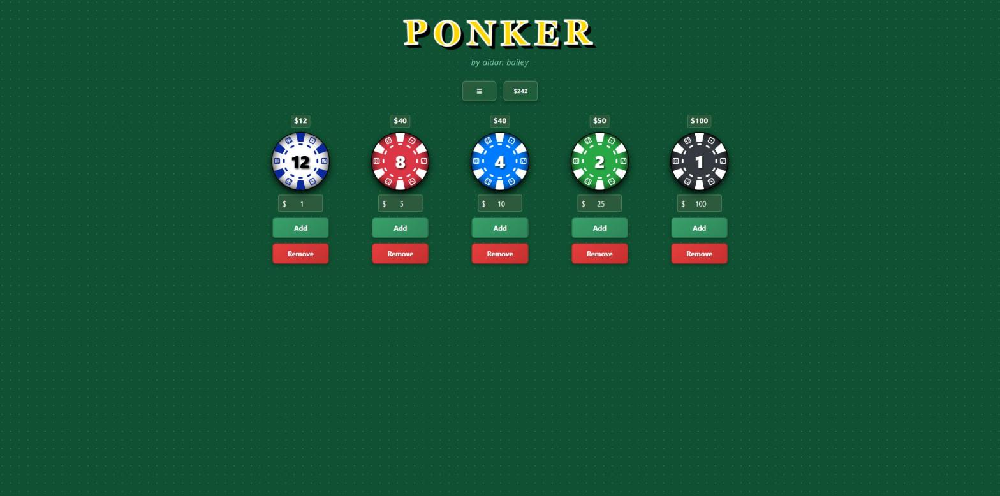

# PONKER 🎲

A poker chip tracker for players who haven't got the knack of counting their stack yet. Set up your chips, tap as they come and go, and always know what you're holding.

**[ponker.aidanbailey.com](https://ponker.aidanbailey.com)**



## Features

- Add and remove chips with a tap, or swipe down and up on a phone
- Custom chip values and colors (click or long press a chip)
- Presets for common home games and casino denominations
- Cashout summary with a bills and coins breakdown, ready to share with the table
- Felt, dark and light themes
- Saves automatically in your browser

## Stack

React, TypeScript and Vite, with plain CSS. The only other runtime dependency is the bundled Atkinson Hyperlegible font used on the menu cards.

```
src/
  lib/          chip data, cashout maths, storage (no React)
  hooks/        stored state, chip gestures
  components/   UI
  styles.css    theme tokens and all styling
```

## Development

```bash
npm install
npm run dev        # http://localhost:3000, also reachable from your phone on the same wifi
npm test
npm run lint
npm run typecheck
npm run build
```

Built by Aidan Bailey. [Buy me a coffee](https://ko-fi.com/aidanlbailey) if it saved you at the table.
